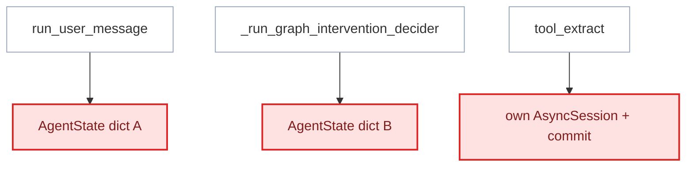
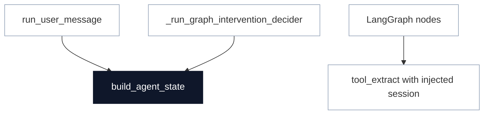

# Consolidate AgentState Construction

**Status:** proposed
**Review date:** 2026-07-04
**Source report:** `/var/folders/ww/s0hkrfgs7mzcfw5wl8_g1v2m0000gn/T/kaizen-architecture-review-20260704-153344.html#agent-state-construction`
**Recommendation:** Strong
**Area:** agent
**Milestone/doc anchor:** `docs/milestones/06-proactive-agent.md`

## Problem

`run_user_message` and `_run_graph_intervention_decider` in
`app/agent/runner.py` each construct an identical AgentState dictionary from
scratch — same 14 fields, same defaults. Adding a state field requires touching
both construction sites. Separately, `tool_extract` in `app/agent/tools.py`
opens its own `AsyncSession` to fetch habit plans, then commits — even though
the caller graph node already has a session context. This creates an invisible
transaction boundary inside the agent graph.

## Current Shape

- `app/agent/runner.py`: `run_user_message` (line 46) builds AgentState dict;
  `_run_graph_intervention_decider` (line 126) builds an identical AgentState
  dict with different field values.
- `app/agent/tools.py`: `tool_extract` (line 14) opens its own
  `AsyncSessionLocal`, calls `get_habit_plan_context`, and commits.
- `app/agent/state.py`: defines `AgentState` TypedDict (14 fields) but has no
  factory function.
- `app/agent/graph.py`: nodes access state fields by key; no session is
  propagated to tool calls.

## Proposed Shape

Create a `build_agent_state` factory in `app/agent/state.py` (or keep it in
`runner.py`) that accepts a typed runner context and returns a valid AgentState
dict. Use it from both `run_user_message` and `_run_graph_intervention_decider`.

Pass the runner's session into tool calls so the graph and tools share one
transactional boundary. This means `tool_extract` receives a session parameter
instead of opening its own.

## Before

## After

## Expected Wins

- locality: state shape is defined once
- leverage: adding a field touches one factory
- tests: state factory is testable in isolation
- session: tools share the graph's transaction

## Risks And Trade-offs

- Passing session to graph nodes and tools changes the current calling pattern.
  Graph nodes currently have no session parameter.
- `run_user_message` pre-builds habit state summary before the graph runs; the
  factory must account for pre-computed and graph-computed fields.
- Mem0 calls in `tool_recall` run in executor — session sharing doesn't affect
  them.

## Acceptance Criteria

- [ ] One `build_agent_state` factory produces correct AgentState for both
      `user_message` and `tick` event kinds.
- [ ] `tool_extract` accepts an optional `AsyncSession` parameter; when absent,
      it opens its own (backward compat).
- [ ] Graph nodes that need habit plans receive a session from the runner.
- [ ] `uv run pytest tests/agent/ tests/test_webhook.py` passes
- [ ] `uv run ruff check .` passes

## Grilling Notes

_No grilling yet — awaiting user choice._
