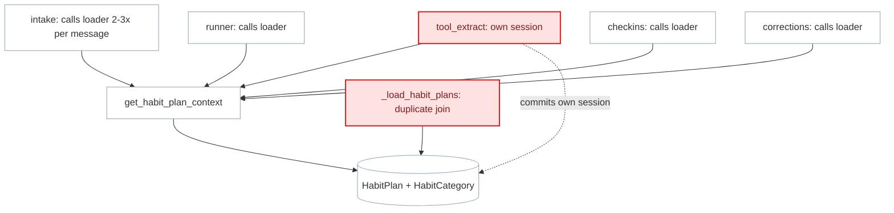
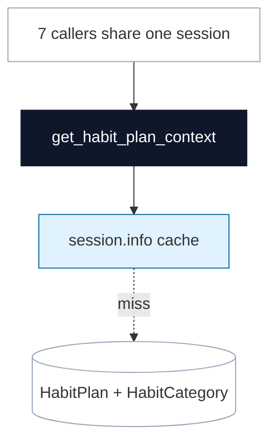

# Decouple Habit Plan Context from Per-Caller Session Management

**Status:** proposed
**Review date:** 2026-07-04
**Source report:** `/var/folders/ww/s0hkrfgs7mzcfw5wl8_g1v2m0000gn/T/kaizen-architecture-review-20260704-153344.html#habit-plan-context-loading`
**Recommendation:** Worth exploring
**Area:** backend
**Milestone/doc anchor:** `docs/milestones/12-habit-plan-onboarding.md`

## Problem

`get_habit_plan_context` is called from 7+ locations across the codebase.
Several callers also perform their own additional queries to load habit plans
(e.g. `dashboard.py` has `_load_habit_plans` that duplicates the join).
`tool_extract` in `app/agent/tools.py` opens its own `AsyncSession` and commits
it, shadowing the caller's session. The result is a shallow interface: every
caller must know when to open a session, when to commit, and whether the plan
context is already loaded.

## Current Shape

- `app/habits/plan.py`: `get_habit_plan_context` (line 151) runs
  `ensure_default_habit_plan` and loads plans + categories. No caching.
- `app/agent/tools.py`: `tool_extract` (line 14) opens its own
  `AsyncSessionLocal`, calls `get_habit_plan_context`, and commits.
- `app/agent/runner.py`: `_build_habit_state_summary` (line 198) calls
  `get_habit_plan_context` with the runner's session.
- `app/telegram/intake.py`: calls `get_habit_plan_context` in
  `_handle_habit_command`, `_handle_log_message`, and indirectly in
  `handle_habit_flow_message`.
- `app/dashboard.py`: calls `get_habit_plan_context` and separately runs
  `_load_habit_plans` which duplicates the plan+category join.
- `app/checkins/service.py`: calls `get_habit_plan_context`.
- `app/corrections/service.py`: calls `get_habit_plan_context`.

## Proposed Shape

Make `get_habit_plan_context` cache its result in `session.info` so repeated
calls within the same transaction are free (the plan rarely changes within a
request). Accept an optional `AsyncSession` dependency in `tool_extract` so
graph nodes can share the caller's session.

Remove `_load_habit_plans` from `dashboard.py` and route it through the shared
loader. Keep the `ensure_default_habit_plan` seed logic inside the loader.

## Before

## After

## Expected Wins

- leverage: one session, many callers, zero duplicate queries
- locality: plan loading logic is not repeated
- tests: session-caching behavior is testable
- interface: `tool_extract` stops opening its own session

## Risks And Trade-offs

- `session.info` caching is not transactional — if a habit plan is modified
  mid-request (e.g. during a command flow), the cache may be stale. In practice,
  command flows own their own sessions and plan changes flush before the next
  request.
- Cache invalidation is implicit (session ends). This is acceptable because
  FastAPI creates a new session per request.
- Overlap with candidate 2 (AgentState construction) — fixing `tool_extract`'s
  session isolation is shared work.

## Acceptance Criteria

- [ ] `get_habit_plan_context` caches result in `session.info`; second call
      within the same transaction returns the cached value
- [ ] `tool_extract` accepts an optional `AsyncSession`; when provided, uses it
      instead of opening a new one
- [ ] `dashboard.py` uses `get_habit_plan_context` instead of `_load_habit_plans`
- [ ] Caching test: two calls to `get_habit_plan_context` in one session
      produce one DB query
- [ ] `uv run pytest tests/habits/test_habit_plan.py tests/test_dashboard.py tests/test_webhook.py` passes
- [ ] `uv run ruff check .` passes

## Grilling Notes

_No grilling yet — awaiting user choice._
