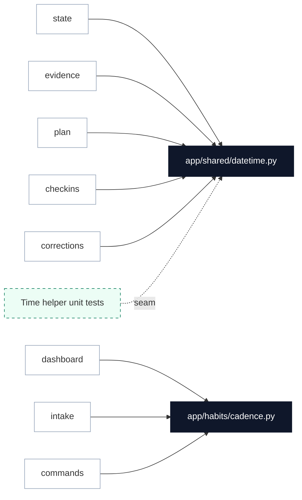

# Deduplicate Timezone and Cadence Helpers

**Status:** resolved
**Review date:** 2026-07-04
**Source report:** `/var/folders/ww/s0hkrfgs7mzcfw5wl8_g1v2m0000gn/T/kaizen-architecture-review-20260704-153344.html#dedupe-helpers`
**Recommendation:** Strong
**Area:** backend
**Milestone/doc anchor:** N/A — infrastructure hygiene spanning all milestones

## Problem

`_app_datetime`, `_app_date`, and `_day_start` are re-implemented identically in
five modules: `app/habits/state.py`, `app/habits/evidence.py`,
`app/habits/plan.py`, `app/checkins/service.py`, and
`app/corrections/service.py`. `_format_cadence` has three variant copies in
`app/dashboard.py`, `app/telegram/intake.py`, and `app/habits/commands.py` with
different parameter types. Timezone logic and cadence formatting are shallow
because callers supply their own copies instead of using one deep interface.

## Current Shape

- `app/habits/state.py`: `_app_datetime` (line 377), `_parse_window`
- `app/habits/evidence.py`: `_app_date` (line 375), `_day_start` (line 371)
- `app/habits/plan.py`: `_app_datetime` (line 233), `_day_start` (line 229)
- `app/checkins/service.py`: `_app_datetime` (line 284), `_day_start` (line 280)
- `app/corrections/service.py`: `_app_datetime` (line 212), `_app_date` (line 220)
- `app/dashboard.py`: `_format_cadence(plan: HabitPlanContext)` (line 232)
- `app/telegram/intake.py`: `_format_cadence(plan: HabitPlanContext)` (line 261)
- `app/habits/commands.py`: `_format_cadence(cadence: CadenceSpec | None)` (line 703)

## Proposed Shape

Create `app/shared/datetime.py` exporting `app_now()`, `app_date(dt)`, and
`day_start(day)`. Each function uses `get_app_timezone()` from config.

Move the canonical `format_cadence` to `app/habits/cadence.py`. The function
should accept a protocol (`HasCadence`) that both `HabitPlanContext` and
`CadenceSpec` satisfy: `cadence_type: str` and `cadence_value: Any | None`.

Delete the private helpers from the five caller modules and replace them with
imports.

## Before

```mermaid
flowchart TD
  A[state.py _app_datetime] B[evidence.py _app_date, _day_start]
  C[plan.py _app_datetime, _day_start] D[checkins _app_datetime, _day_start]
  E[corrections _app_datetime, _app_date] F[dashboard _format_cadence]
  G[intake _format_cadence] H[commands _format_cadence]

  classDef leak fill:#fee2e2,stroke:#dc2626,stroke-width:2px,color:#7f1d1d;
  class A,B,C,D,E,F,G,H leak
```

## After



## Expected Wins

- locality: timezone rules live once
- leverage: one import, six callers
- tests: timezone edge cases exercise one function
- interface: `format_cadence` protocol removes `Any` casts

## Risks And Trade-offs

- `app/shared/` is a new package. Keep it minimal — only timezone helpers for now.
- The `_format_cadence` variants differ subtly: `dashboard.py` and `intake.py`
  accept `HabitPlanContext`; `commands.py` accepts `CadenceSpec`. The protocol
  must handle both or a second overload may be justified.
- Moving `_day_start` from `evidence.py` may break relative imports; verify.

## Acceptance Criteria

- [ ] `app/shared/datetime.py` exports `app_now`, `app_date`, `day_start`
- [ ] `app/habits/cadence.py` exports `format_cadence` with a `HasCadence` protocol
- [ ] All duplicate `_app_datetime`, `_app_date`, `_day_start` helpers are removed
- [ ] All duplicate `_format_cadence` helpers are removed
- [ ] Tests for timezone edge cases (DST boundary, zoneinfo correctness) pass
- [ ] `uv run pytest` passes
- [ ] `uv run ruff check .` passes

## Grilling Notes

**Grilling 2026-07-04:** Milestone was concrete and implementation-ready. Key decision: unify `_format_cadence` display to dashboard style (`/`.title()). All three variants were divergent (dashboard: `/`.title(), intake/commands: `, ` lowercase). Chose dashboard style as canonical.
