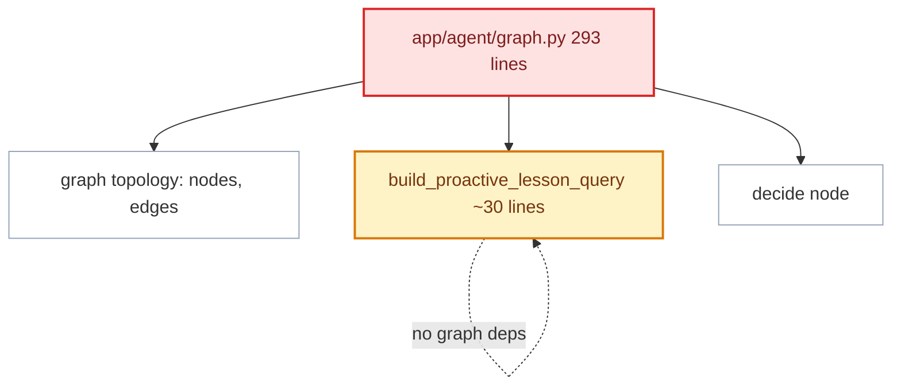
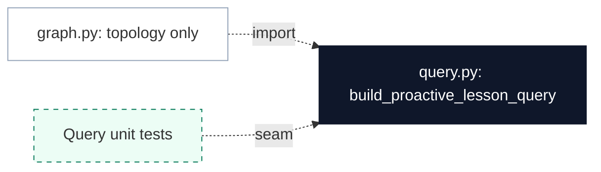

# Separate Proactive Lesson Query Builder from Graph

**Status:** proposed
**Review date:** 2026-07-04
**Source report:** `/var/folders/ww/s0hkrfgs7mzcfw5wl8_g1v2m0000gn/T/kaizen-architecture-review-20260704-153344.html#query-builder-graph`
**Recommendation:** Worth exploring
**Area:** agent, RAG
**Milestone/doc anchor:** `docs/milestones/06-proactive-agent.md`, `docs/milestones/10-lesson-grounded-reflection.md`

## Problem

`build_proactive_lesson_query` in `app/agent/graph.py` is pure deterministic
logic: it parses habit state summary lines, detects drift keywords from history,
and builds a query string. It has no LangGraph, LLM, or async dependency.
Placing it inside the graph module makes the graph file larger and prevents
testing the query builder without invoking the full graph machinery.

## Current Shape

- `app/agent/graph.py`: `build_proactive_lesson_query` (line 233) parses
  `habit_state_summary` text lines, checks for drift words in history, and
  assembles a retrieval query.
- `app/agent/graph.py`: `retrieve_proactive_lessons` node (line 91) calls the
  query builder and feeds it to `tool_retrieve`.
- No tests exercise query builder logic independently.

## Proposed Shape

Extract `build_proactive_lesson_query` into `app/agent/query.py` (or
`app/habits/query.py` if it fits the habits domain better). The graph's
`retrieve_proactive_lessons` node calls the query builder as a plain function
import. Tests can validate drift detection, empty-state handling, and query
truncation without constructing AgentState or invoking the graph.

## Before

## After

## Expected Wins

- locality: query construction owns drift detection
- tests: query builder unit-tests without a graph
- interface: one function, no state object needed
- graph: module stays focused on node/edge topology

## Risks And Trade-offs

- The function is only ~30 lines; extracting it creates a new module for a
  small responsibility. The case strengthens if drift detection becomes richer
  (engagement scoring, cooldown windows, multi-habit correlation) in a future
  milestone.
- Consider `app/habits/query.py` if the function logically belongs with habit
  domain logic rather than agent orchestration.

## Acceptance Criteria

- [ ] `app/agent/query.py` (or similar) exports `build_proactive_lesson_query`
- [ ] `app/agent/graph.py` imports and calls it in `retrieve_proactive_lessons`
- [ ] Unit tests cover: all habits complete → None, missing habits → query text,
      drift words present → selection, drift words absent with no missing → None,
      long habit list truncation at 6
- [ ] `uv run pytest tests/agent/test_proactive.py` passes
- [ ] `uv run ruff check .` passes

## Grilling Notes

_No grilling yet — awaiting user choice._
